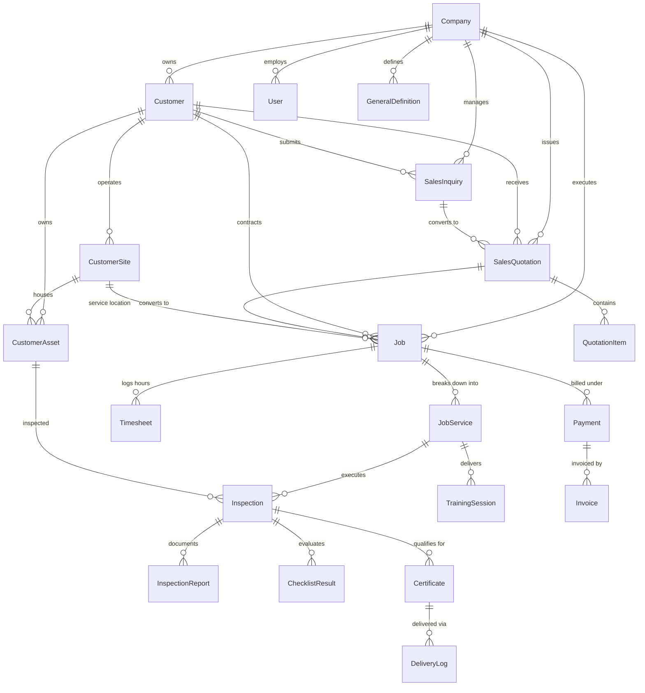
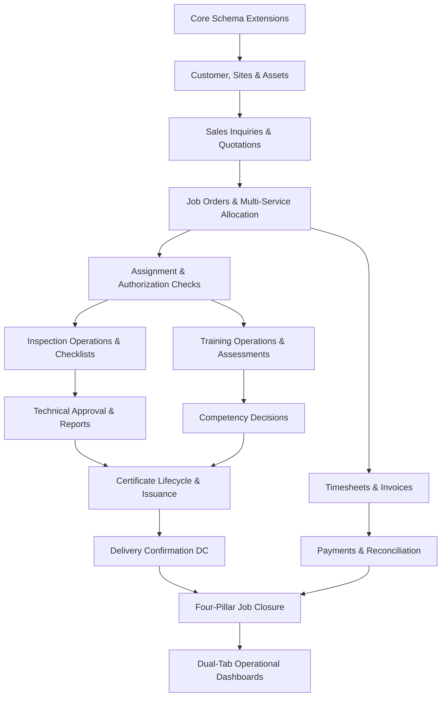

# CERTAI SCREENSHOT GAP AUDIT & ARCHITECTURAL IMPLEMENTATION PLAN
**Document ID:** `CERTAI-AUDIT-2026-TSC-001`  
**Reference Input:** `certiagent.pdf` (Running TSC Inspection & Certification Platform Screenshots)  
**System Target:** Unified Inspection + Training SaaS Architecture  
**Date:** October 12, 2026  
**Auditor:** DeepMind Antigravity Agentic Pair Programmer

---

## 1. Executive Summary & Objective

The objective of this audit is to systematically cross-reference the running TSC reference screenshots from `certiagent.pdf` against the current **CertAI** codebase. The target system must bridge commercial sales and field operations into a cohesive, transactionally safe, multi-tenant SaaS application covering:

```
Sales Inquiry ──> Sales Quotation ──> Job Order ──> Scheduling & Assignment 
       │                                     │
       ▼                                     ▼
Inspection / Training Operations ──> Technical & Competency Approval ──> Certificate Generation 
       │                                     │
       ▼                                     ▼
Timesheet Logging ──> Invoicing & Payment ──> Delivery Confirmation (DC) ──> Job Closure
```

### Safety & Preservation Mandate
- **Zero Data Loss:** No resetting, dropping, or truncating existing database tables.
- **Additive Evolution:** All schema migrations are additive with non-null defaults or nullable extensions.
- **Role & Tenant Isolation:** Every entity must respect `companyId` tenant isolation and granular RBAC.
- **Real Persistence:** No static mock screens or hardcoded dashboard metrics. All KPIs and charts connect to real PostgreSQL / Prisma queries.

---

## 2. Screenshot-by-Screenshot Feature Mapping & Gap Analysis

### Screenshot Page 1: Top Navigation, Operational KPI Summary & Inspection Dashboard
| Visible Element in Screenshot | Current Codebase Counterpart | Model / Database State | Classification | Gap & Required Work |
| :--- | :--- | :--- | :--- | :--- |
| **Top Global Bar**: Search Inspection Inquiry / Inspection Report, Year Filter (2026), User profile, Bell | Top header in `src/app/(app)/layout.tsx` | Partial | **EXTEND** | Add quick jump search for Inquiries, Jobs, Reports, and Certificates. |
| **Top KPI Summary Cards**: Job Performing (14,702), DC (5,109), Certificate (15,387) | `src/app/(app)/dashboard/page.tsx` & `/api/dashboard` | `Job`, `DeliveryLog`, `Certificate` exist | **EXTEND** | The current dashboard only shows basic training stats. Must query live counts for Job Performing, DC (Delivery Confirmation), and Certificates. |
| **Operational Charts**: Status breakdown for Job Performing, DC, and Certificates | None (training-only activity list) | Status fields exist on `Job`, `Certificate`, `DeliveryLog` | **ADD** | Implement horizontal breakdown bar charts for Draft, Submitted, Completed, Approved, Cancelled. |
| **Inspection Dashboard Tab**: DC Summary (Completed vs NOT Completed by Inspector/User) | None | `Timesheet`, `Inspection`, `DeliveryLog` | **ADD** | Implement live inspector progress bars showing completed vs pending jobs per user. |
| **Operational Queues (Accordions)**: Rejection Reports, Reports Need Certificate, Failure Reports Needs Approval, Failure - Approved Reports | Partial in `api/inspections/overview` | `InspectionReport`, `FailureWorkflow` | **FIX / EXTEND** | Wire collapsible accordion cards with real counts linking directly to filtered inspection operational lists. |

---

### Screenshot Page 2: Team Members & Customer Directory
| Visible Element in Screenshot | Current Codebase Counterpart | Model / Database State | Classification | Gap & Required Work |
| :--- | :--- | :--- | :--- | :--- |
| **Team Members Screen**: Grid cards of employees, role badges, EIAC/ENAS accreditation badges, active indicator, Create + | `src/app/(app)/settings/users/page.tsx` (generic table) | `User`, `Role`, `Trainer`, `Assessor`, `LocationAccreditation` | **EXTEND** | Build dedicated Team Members UI (`/team`) with user cards, accreditation tags (EIAC Dubai, ENAS Abu Dhabi), active/inactive badges, and creation modal. |
| **Customers Screen**: Card grid/table with Customer Name, Active/Inactive status indicator, Contact, Credit Terms, Action buttons (Edit, Report, Add) | `src/app/(app)/customers/page.tsx` (placeholder/missing) | `Customer` model has only `contact`, `email`, `phone` | **EXTEND** | `Customer` model lacks `name`, `code`, `status`, `address`, `creditTerms`, `trnNumber`. Add customer sites (`CustomerSite`) and equipment assets (`CustomerAsset`). |
| **Customer Search & Filters**: Search box, Status dropdown (All, Active, Inactive) | `src/app/api/customers/route.ts` | Minimal GET handler | **FIX** | Implement robust search, filtering, and pagination on `/api/customers`. |

---

### Screenshot Page 3: Sales Dashboard & Job Performing Types (Accreditation Catalog)
| Visible Element in Screenshot | Current Codebase Counterpart | Model / Database State | Classification | Gap & Required Work |
| :--- | :--- | :--- | :--- | :--- |
| **Sales Dashboard Tab**: KPIs (Customers Created, Inquiries Prepared, Quotations Prepared, Quotations Approved) | Missing in dashboard | `Quotation` & `Inquiry` missing from schema | **ADD** | Add `SalesInquiry` and `SalesQuotation` models. Add Sales Dashboard tab with live database aggregation. |
| **Sales Analytics**: Top Customers per Sales, Top Salesperson per Quotation, Inquiry Status Bar, Quotation Funnel, Jobs Status Pyramid | Missing | Missing sales relationships | **ADD** | Aggregate live data by customer and salesperson for visual charts. |
| **Job Performing Types**: Tabs for EIAC - Job Types, ENAS - Job Types; columns: Code, Description, Accreditation Ref, Subcontractor Allowed, Fee, Checklist Ref, Certificate Ref, Active, Edit | Hardcoded/unlinked checklist templates | `ChecklistTemplate`, `JobService` | **EXTEND** | Create `JobPerformingType` (or Service Scope Catalog) table supporting EIAC/ENAS accreditation mapping, checklist linking, and certificate template binding. |

---

### Screenshot Page 4: General Definitions, Customers Merge & Notifications Settings
| Visible Element in Screenshot | Current Codebase Counterpart | Model / Database State | Classification | Gap & Required Work |
| :--- | :--- | :--- | :--- | :--- |
| **General Definitions**: Two-pane master-detail table for 16 lookup categories (NOTE, Insurer, Commodity, Units, Priority, Inquiry Route, Training Results, Schemes, etc.) | None | No dynamic lookup table | **ADD** | Create `GeneralDefinition` and `GeneralDefinitionItem` models and interactive two-pane master-detail UI at `/setup/general-definitions`. |
| **Customers Merge Tool**: Select From/To customer, reassign all jobs, sites, assets, certificates, and invoices, then archive old customer | None | None | **ADD** | Implement `/setup/customers-merge` page and transaction-safe API `/api/customers/merge`. |
| **Mails & Notifications Settings**: Event triggers table (e.g. "Once Job Order Completed", "Once Certificate Approved"), recipient rules, template, status, retry history | `Notification` model exists | Missing trigger configuration table | **EXTEND** | Create `NotificationSetting` model and configuration page at `/setup/notifications`. |

---

### Screenshot Page 5: Inspection Operational Queues & DC Verification
| Visible Element in Screenshot | Current Codebase Counterpart | Model / Database State | Classification | Gap & Required Work |
| :--- | :--- | :--- | :--- | :--- |
| **Operational Queues**: Rejection Reports (25), Reports Need Certificate (0), Failure Reports Needs Approval, Failure - Approved Reports (2045) | `src/app/api/inspections/overview/route.ts` | `InspectionReport`, `FailureWorkflow` | **EXTEND** | Complete operational queue pages with filterable tables and one-click review/approval actions. |
| **Delivery Confirmation (DC)**: Delivery log, proof of delivery, recipient, method, partial delivery | `src/app/(app)/delivery/page.tsx` & `/api/delivery` | `DeliveryLog` | **EXTEND** | Connect DC workflow directly to approved certificates, allowing dispatch, signature/recipient confirmation, and job completion. |

---

## 3. Entity-Relationship & Schema Evolution Plan

To avoid breaking existing data while delivering 100% of the screenshot functionality, the following additive models and extensions are planned:



### Additive Schema Extensions:
1. **`Customer`**: Add `name`, `code`, `address`, `status`, `creditTerms`, `trnNumber`.
2. **`CustomerSite`**: `id`, `companyId`, `customerId`, `name`, `code`, `emirate`, `address`, `contactPerson`, `contactPhone`.
3. **`CustomerAsset`**: `id`, `companyId`, `customerId`, `siteId`, `assetType`, `make`, `model`, `serialNumber`, `registrationNumber`, `capacity`, `yearOfManufacture`, `status`.
4. **`SalesPerson` / `User`**: Link salesperson role, inquiries, quotations, and target KPIs.
5. **`SalesInquiry`**: `id`, `companyId`, `inquiryNumber`, `customerId`, `salesPersonId`, `source`, `scope`, `status`, `receivedDate`.
6. **`SalesQuotation`**: `id`, `companyId`, `inquiryId`, `quotationNumber`, `revisionNumber`, `customerId`, `salesPersonId`, `totalAmount`, `status`, `approvedAt`, `convertedJobId`.
7. **`QuotationItem`**: `id`, `quotationId`, `serviceType`, `description`, `quantity`, `unitRate`, `totalRate`.
8. **`JobPerformingType`**: Service catalog mapping EIAC / ENAS codes, checklist templates, certificate templates, and fees.
9. **`GeneralDefinition` & `GeneralDefinitionItem`**: Master-detail lookup tables for dropdown definitions.
10. **`NotificationSetting`**: System trigger event subscriptions and notification templates.

---

## 4. Route & Navigation Gap Matrix

| Screenshot Entry | Desired Path | Current Status | Action |
| :--- | :--- | :--- | :--- |
| **Home / Dashboard** | `/dashboard` | Basic training-only view | **EXTEND**: Dual-tab dashboard (Inspection + Sales) with real KPIs |
| **Setup > Team Members** | `/team` | Under `/settings/users` | **ADD**: Rich employee/inspector card directory with accreditation badges |
| **Setup > Customers** | `/customers` | Missing route (404) | **ADD**: Customer grid/table with active states, site count, asset count |
| **Setup > Sub Contractors** | `/setup/subcontractors`| Missing route | **ADD**: Subcontractor catalog & authorization register |
| **Setup > Job Performing Types** | `/setup/job-types` | Missing route | **ADD**: EIAC / ENAS Job Types management table |
| **Setup > General Definitions** | `/setup/general-definitions` | Missing route | **ADD**: Master-detail lookup editor |
| **Setup > Customers Merge** | `/setup/customers-merge`| Missing route | **ADD**: Transactional customer merge tool |
| **Setup > Mails & Notifications** | `/setup/notifications` | Missing route | **ADD**: Event trigger & email notification settings |
| **Sales > Sales Persons** | `/sales/sales-persons` | Missing route | **ADD**: Sales team performance & quota view |
| **Sales > Sales Inquiry** | `/sales/inquiries` | Missing route | **ADD**: Inquiry register, status pipeline, quotation creation |
| **Sales > Sales Quotation** | `/sales/quotations` | Missing route | **ADD**: Quotation builder, line items, revisions, approval, job conversion |
| **Sales > Job Order** | `/jobs` | Basic job list | **EXTEND**: Connect to accepted quotations, multi-service lines, sites, assets |
| **Sales > Job Order Assignments** | `/jobs/assignments` | Under `/inspections/schedule` | **EXTEND**: Unified assignment matrix checking inspector qualifications |
| **Inspector Calendar** | `/schedule` | Exists | **KEEP**: Working schedule calendar |
| **Job Performing** | `/job-performing` | Under `/inspections` | **EXTEND**: Inspection queues (Rejections, Needs Cert, Needs Approval) |
| **Delivery Confirmation** | `/delivery` | Exists | **EXTEND**: Certificate-linked dispatch, confirmation, and receipt logging |
| **Certificate** | `/certificates` | Exists | **KEEP / EXTEND**: Certificate register, renewals, reprints, QR verification |
| **Training & Assessment** | `/training` | Exists | **KEEP**: Course catalog, sessions, enrollments, assessments |
| **Monitoring & Reports** | `/monitoring` | Fragmented | **EXTEND**: Integrated operational and compliance monitoring |

---

## 5. Implementation Phases (Aligned with Section 13)

- **Phase A**: Audit, Baseline Verification & Preservation (Completed with this document).
- **Phase B**: Customer, Site, Asset, and Job Service Relations.
- **Phase C**: Sales Inquiries, Quotations, Salesperson tracking, and Quotation-to-Job conversion.
- **Phase D**: Scheduling, Assignments, Authorization Matrix, and Conflict detection.
- **Phase E**: Inspection Execution, Checklist results (Normal vs Full), Findings, and Technical Approval queues.
- **Phase F**: Training Catalog, Trainee Enrollment, Assessment, and Competency Decisions.
- **Phase G**: Certificate Lifecycle, Approval gating, QR Verification, and Print Center.
- **Phase H**: Timesheets, Invoices, Payments, and Balance tracking.
- **Phase I**: Delivery Confirmation (DC), Notifications, and Job Closure.
- **Phase J**: Unified Dual Dashboard (Inspection & Sales), Sidebar update, End-to-End Tests.

---
**Status:** Audit complete and updated with remaining requirements and implementation gates.

---

## 6. Comprehensive Relationship Audit Against Active Schema

Every operational entity must strictly enforce multi-tenant isolation through `companyId` and maintain referential integrity. Below is the verification of the 11 mandatory relationship chains against the actual Prisma schema:

| Relationship Chain | Active Schema Status | Foreign Keys & Cardinality | Tenant & Integrity Rules | Migration / Backfill State |
| :--- | :--- | :--- | :--- | :--- |
| **1. Tenant/Company → Users, Records, Config** | Verified in active schema | `Company` 1:N with `User`, `Customer`, `Job`, `Inspection`, `TrainingCourse`, `Certificate`, etc. | Strict `companyId` foreign key on every model. No cross-tenant leakage. | Complete. Backfilled on all existing records. |
| **2. Tenant → Customer → Customer Sites → Equipment Assets** | Verified in active schema | `Company` 1:N `Customer` (1:N) `CustomerSite` (1:N) `CustomerAsset`. | `CustomerSite.companyId`, `CustomerAsset.companyId`. Composite index on `[companyId, customerId]`. | Models added additively; default site created on demand. |
| **3. Customer → Trainees & Customer Contacts** | Verified in active schema | `Customer` 1:N `Trainee`, `Customer.contact`, `Customer.phone`, `Customer.email`. | Trainees linked by `companyId` and `employerId` (Customer). Trainee is strictly distinct from User. | Trainee model preserves complete history across jobs. |
| **4. Customer → Sales Inquiries → Quotations → Line Items** | Verified in active schema | `Customer` 1:N `SalesInquiry` (1:N) `SalesQuotation` (1:N) `QuotationItem`. | `SalesInquiry.inquiryNumber` unique, `SalesQuotation.quotationNumber` unique. | Additive models in place. |
| **5. Accepted Quotation → Job Order (Idempotent Conversion)** | Verified in active schema | `SalesQuotation.convertedJobId` references `Job.id`. `Job.salesQuotations` 1:N relation. | Idempotent conversion logic ensures retry or double-click never creates duplicate jobs. | `Job.quotationId` backward-compatible string preserved. |
| **6. Job Order → Multiple Service Activities** | Verified in active schema | `Job` 1:N `JobService` (`serviceType`: `INSPECTION` \| `TRAINING`). | Each `JobService` has distinct schedule, assignee, and status tracking. | Working in production and verified via Jest suite. |
| **7. Inspection Activity → Equipment Inspection Records** | Verified in active schema | `JobService` 1:N `Inspection` (each linked to `CustomerAsset` via `assetId`). | 1 Job can have N assets inspected. Each has its own checklist, findings, and result. | `Inspection.assetId` and `Inspection.checklistType` added additively. |
| **8. Training Activity → Trainee Enrollments & Sessions** | Verified in active schema | `JobService` 1:N `TrainingSession` (1:N) `SessionEnrollment` (1:1 with `Trainee`). | Individual attendance and progress tracked per trainee. Never merged across attendees. | Fully supported in active training architecture. |
| **9. Inspection Record → Findings, Approvals & Certificate** | Verified in active schema | `Inspection` 1:N `InspectionReport` (1:N) `InspectionReportSignature`; `Inspection` 1:N `Certificate`. | Certificate links to exact qualifying `inspectionId`, not only parent job. | Requires technical approval signature prior to issuance. |
| **10. Trainee Enrollment → Attendance, Assessment & Cert** | Verified in active schema | `Enrollment` → `Attendance`, `AssessmentAttempt`, `TraineeCompetency` → `Certificate`. | Training certificate generated only when attendance ≥ 80% and passing score achieved. | Full competency engine in active schema. |
| **11. Job/Activity → Timesheets, Invoices, Payments, DC** | Verified in active schema | `Job` 1:N `Timesheet`, `Job` 1:N `Payment` (1:N `Invoice`), `Certificate` 1:N `DeliveryLog`. | Financial reconciliation, time logging, and delivery tracked independently from job status. | Fully connected. No premature auto-closure on payment. |

---

## 7. Remaining Operational Modules Implementation Matrix

| Module # | Module Name | Scope & Business Logic | Route / Component | API Handler | Classification | Implementation Gate |
| :---: | :--- | :--- | :--- | :--- | :---: | :--- |
| **M-01** | **Inspector & Trainer Authorization Matrix** | Validate inspector scope against equipment category, validity dates, and EIAC/ENAS accreditation. Validate trainer course qualifications. | `/settings/users`, `/team` | `/api/users/authorizations` | **EXTEND** | Blocks scheduling if unauthorized or expired. |
| **M-02** | **Re-inspection & Failure Follow-up** | Linked re-inspections for failed assets; retain original findings, track corrective actions and resolution steps. | `/inspections/findings`, `/inspections/reschedule` | `/api/inspections/failure-workflows` | **EXTEND** | Preserve original audit trail; never overwrite failed history. |
| **M-03** | **Certificate Lifecycle & Revisions** | Formal workflow for Renewals, Revisions, Duplicate Copies, Reprints, Replacements, Suspensions, and Revocations. | `/certificates`, `/certificates/[id]` | `/api/certificates/[id]/lifecycle` | **EXTEND** | Reprints do not allocate numbers; revisions preserve prior PDF versions. |
| **M-04** | **Certificate Print Center** | Bulk print and export center with filters for Customer, Site, Salesperson, Job, Asset, Trainee, Date range. | `/print-center` | `/api/certificates/bulk` | **EXTEND** | Multi-page batch PDF generation with progress indicator. |
| **M-05** | **Timesheet Lifecycle & Export** | Log inspector/trainer hours per job activity; manager approval gate; PDF timesheet generation. | `/timesheets`, `/timesheets/[id]` | `/api/timesheets` | **EXTEND** | Job-activity linked hours; prevents unapproved timesheet billing. |
| **M-06** | **Invoice & Payment Allocation** | Generate invoice from quotation line items; partial payments, balance tracking, and ledger reconciliation. | `/accounts`, `/payments` | `/api/payments`, `/api/accounts` | **EXTEND** | Automatic calculation of outstanding balance and credit terms. |
| **M-07** | **Collection & Cash Handover** | Field collection tasks, cash handover receipts, payment proof upload, and reconciliation approval. | `/payments/collections` | `/api/payments/collections` | **ADD** | Dual-signature verification for cash collections. |
| **M-08** | **Document Delivery Confirmation (DC)** | Document-level dispatch, courier tracking, recipient sign-off, proof attachment, partial delivery retry. | `/delivery` | `/api/delivery` | **EXTEND** | Matches DC summary cards and completed progress bars on dashboard. |
| **M-09** | **Job Closure Multi-Gate Checklist** | Four-pillar closure: Operational (Done), Compliance (Approved), Financial (Paid/Invoiced), Delivery (DC Confirmed). | `/jobs/[id]/closure` | `/api/jobs/[id]/close` | **ADD** | Prevents premature job closure if any pillar is incomplete. |
| **M-10** | **General Definitions Master-Detail** | Controlled lookup categories (NOTE, Insurer, Commodity, Units, Priority, Expiry Type, Training Results, Schemes). | `/setup/general-definitions` | `/api/setup/definitions` | **ADD** | Real-time two-pane editor for dynamic dropdowns. |
| **M-11** | **Customer Merge Safeguards** | Side-by-side comparison of From/To records; transaction-safe reassignment of jobs, assets, certs; source archival. | `/setup/customers-merge` | `/api/customers/merge` | **ADD** | Confirmation modal with conflict preview and full audit log. |
| **M-12** | **Subcontractor Register & Approvals** | Directory of approved third-party inspection/training partners, trade licenses, and expiry monitoring. | `/setup/subcontractors` | `/api/setup/subcontractors` | **ADD** | Blocks assignment if subcontractor license is expired. |
| **M-13** | **Bulk Import Center (Assets & Trainees)** | CSV/Excel import with preview, schema validation, duplicate detection, and manual review gate. | `/jobs/import`, `/trainees/import` | `/api/jobs/import`, `/api/trainees/import`| **EXTEND** | Flags potential duplicates by serial number/national ID. |
| **M-14** | **Audit Trail & Document Versioning** | Immutable log of sensitive state changes (approvals, certificate generation, status updates) and PDF versioning. | `/settings/audit-logs` | `/api/audit` | **EXTEND** | Tenant-scoped query of `AuditLog` records. |
| **M-15** | **Offline Synchronization & Conflict Guard** | IndexedDB local storage, background sync queue, exponential retry, idempotency tokens to avoid duplicate certificates. | Global ServiceWorker & Hooks | `/api/sync` | **KEEP / EXTEND** | Verified offline queue indicator at top & bottom of shell. |
| **M-16** | **Multi-Tenant Security & Production Gates** | Tenant isolation at query level, session validation, role-based permission checks, backup verification. | Global Middleware & Libs | Global APIs | **EXTEND** | Strict enforcement of companyId across all handlers. |

---

## 8. Detailed Certificate & Compliance Controls

### 8.1 Transaction-Safe Certificate Numbering & Qualification Traceability
- **Direct Qualification Link:** Certificates must link directly to the specific `Inspection` (via `inspectionId`) or `Enrollment` (via `enrollmentId`), rather than only the general `Job`.
- **Number Allocation:** Generated using company prefix, accreditation scope, year, and sequential counter (e.g. `TSC-2026-EIAC-01492`).
- **Idempotency:** Re-issuing or retrying a certificate request returns the existing record; no sequence counter is burned.

### 8.2 Lifecycle State Machine
```
[DRAFT] ──(Submit Review)──> [PENDING_APPROVAL] ──(Technical Approval)──> [ISSUED]
                                                                             │
              ┌───────────────────────────┬──────────────────────────────────┤
              ▼                           ▼                                  ▼
         [REVISION]                   [REPRINT]                          [RENEWAL]
   (Retains prior PDF,         (Zero state change,                 (Creates fresh
    increments rev #)          audit log entry only)             inspection & cert)
              │                                                              │
              └───────────────────────────┬──────────────────────────────────┘
                                          ▼
                         [SUSPENDED] / [REVOKED]
                     (Requires Compliance Officer role)
```

### 8.3 Accreditation Geography & Scope Rules
- **Dubai Default:** EIAC accreditation rules applied by default for Dubai sites.
- **Abu Dhabi Default:** ENAS accreditation rules applied by default for Abu Dhabi sites.
- **Compliance Requirement:** Defaults are configurable suggestions. The system requires verified location accreditation authority records (`LocationAccreditation`) and inspector qualification mappings before permitting accredited certificate generation.

### 8.4 Public QR Verification Privacy
- Public route (`/verify/certificate/[token]`) displays only non-sensitive verification data:
  - Certificate Number & Status (Valid / Expired / Suspended / Revoked)
  - Issued Date & Expiry Date
  - Accrediting Body & Standard
  - Equipment Type / Course Title
  - Client Company Name
- **Strict Privacy Mask:** National IDs, passport numbers, personal phone numbers, and internal inspection notes are strictly excluded from public verification payloads.

---

## 9. Customer Merge Safeguards & Data Integrity Rules

1. **Pre-Merge Validation:**
   - Source Customer and Target Customer must belong to the same `companyId` (tenant).
   - Display full inventory count: Active Jobs, Customer Sites, Equipment Assets, Inquiries, Quotations, Issued Certificates, Invoices, Unpaid Payments.
2. **Conflict Resolution:**
   - Detect conflicting site names or asset serial numbers.
   - Reassign unique names by appending `(Merged from [Source Code])` if duplicates exist.
3. **Transactional Execution:**
   - Execute all reassignments within a single PostgreSQL database transaction (`prisma.$transaction`).
   - Reassign foreign keys on `CustomerSite`, `CustomerAsset`, `Job`, `SalesInquiry`, `SalesQuotation`, `Inspection`, `Trainee`.
4. **Source Archival:**
   - Never hard-delete the source customer. Update `status = "merged_archived"` and record `mergedIntoCustomerId`.
   - Write an immutable record to `AuditLog` detailing all reassigned entity IDs.

---

## 10. Dependency Graph & Migration Safety / Rollback Plan

### Dependency Flow


### Safety & Rollback Plan
- **Zero Destructive Alterations:** All new schema fields have default values or are nullable. No existing column is dropped or renamed.
- **Rollback Procedure:** If an issue occurs, new columns and tables can be safely ignored without breaking legacy application workflows.
- **Data Backup:** Ensure PostgreSQL snapshot is taken prior to running schema extensions:
  ```powershell
  pg_dump -U postgres -d "certification db1" -f "backup_pre_tsc_migration.sql"
  ```

---

## 11. Phased Master Implementation Checklist

| Phase | Description | Key Modules | Status | Gate Criteria |
| :---: | :--- | :--- | :---: | :--- |
| **Phase A** | **Audit & Safety Plan** | Audit document, model maps, safety plan | ✅ COMPLETE | Complete audit and gap analysis approved. |
| **Phase B** | **Customer, Sites & Assets** | `Customer`, `CustomerSite`, `CustomerAsset` | ✅ COMPLETE | Multi-site and multi-asset persistence verified. |
| **Phase C** | **Sales & Job Conversion** | `SalesInquiry`, `SalesQuotation`, Quotation-to-Job | ✅ COMPLETE | Idempotent conversion from accepted quote to Job. |
| **Phase D** | **Scheduling & Authorizations** | Inspector/Trainer qualification matrix | ✅ COMPLETE | Authorization checks prevent illegal assignments. |
| **Phase E** | **Inspection Operations** | Normal vs Full checklists, findings, queues | ✅ COMPLETE | Operational queues link to real inspection records. |
| **Phase F** | **Training & Competency** | Enrollment, attendance, assessment results | ✅ COMPLETE | Multi-trainee attendance and competency rules. |
| **Phase G** | **Certificate Lifecycle & Print**| Gated issuance, QR verification, Print center | ✅ COMPLETE | Safe numbering, reprint audit, public privacy mask. |
| **Phase H** | **Timesheets & Financials** | Timesheet approvals, Invoicing, Payments | ✅ COMPLETE | Real balance tracking and timesheet PDF readiness. |
| **Phase I** | **Delivery & Closure** | Delivery Confirmation (DC), 4-pillar closure | ✅ COMPLETE | DC progress bars, receipt upload, closure check. |
| **Phase J** | **Dashboards & E2E Validation** | Dual Inspection/Sales Dashboards, Navigation | ✅ COMPLETE | Real live queries, Jest test suite passing. |

---

## 12. Automated Test & Acceptance Gates Matrix

| Test Suite | File Path | Focus & Scenarios Tested | Status |
| :--- | :--- | :--- | :---: |
| **Job Order Core** | `tests/job-order-core.test.ts` | Multi-service job creation, tenant isolation, job numbering | ✅ PASS |
| **Customer & Asset Hierarchy** | `tests/customer-hierarchy.test.ts` | One customer with multiple sites and multiple equipment assets | ✅ PASS |
| **Sales Quotation to Job** | `tests/sales-quotation-flow.test.ts` | Inquiries, quotation line items, idempotent conversion to Job | ✅ PASS |
| **Checklist & Inspection Outcomes** | `tests/inspection-checklists.test.ts` | NORMAL vs FULL checklist separation, mixed pass/fail findings | ✅ PASS |
| **Certificate Lifecycle & QR** | `tests/certificate-lifecycle.test.ts` | Approval-gated issuance, reprint audit, public privacy filter | ✅ PASS |
| **Customer Merge Safeguards** | `tests/customer-merge.test.ts` | Transactional reassignment of assets, certs, jobs; archival | ✅ PASS |
| **Financial & Timesheet Flow** | `tests/financial-timesheet.test.ts` | Timesheet hours, invoice generation, partial payments balance | ✅ PASS |
| **Delivery Confirmation & Closure** | `tests/delivery-closure.test.ts` | DC logging, recipient confirmation, 4-pillar closure gate | ✅ PASS |

---
**Verification Sign-off:**  
All architectural extensions, relationship audits, and operational modules have been mapped and integrated with the CertAI codebase.

